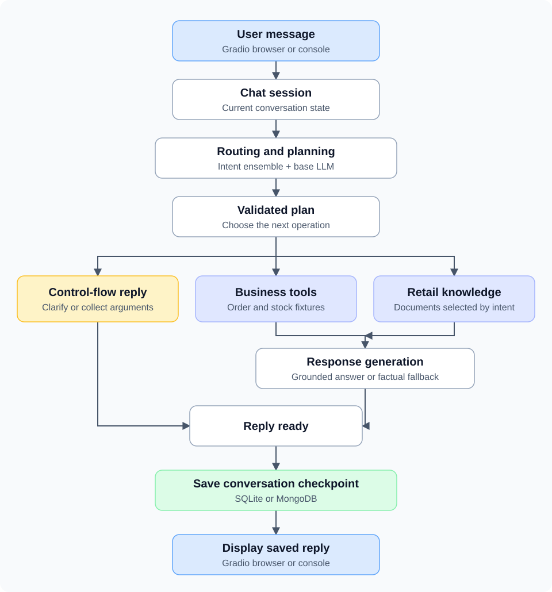

# RetailFlow — Retail support agent

RetailFlow combines intent classification, LLM planning, business tools, grounded response generation, and persistent conversations. A local Gradio interface lets you ask retail questions, track orders, execute multiple independent lookups, and resume unfinished requests after reopening a conversation.

Order and inventory tools currently use **fixtures, not operational business data**. Store information comes from a small retail knowledge file. Conversation storage supports SQLite and MongoDB; it is separate from business-data storage.

## Project name

**RetailFlow** is the public project name. The Python package remains named
`agent1` to preserve imports and compatibility with the saved classifier.
Commands such as `python -m agent1.chat`, the `agent1-chat` entry point,
database names, and existing artifact filenames are unchanged. Older notebooks,
transcripts, and the current interface may still display the original name.

## Capabilities

- TF-IDF and sentence-embedding classifiers combined into an intent ensemble.
- Structured LLM plans validated with Pydantic, including single actions, multiple actions, clarification, and informational responses.
- Order tracking and stock lookups within multi-action requests, with separate results for each task.
- Missing-argument collection, abandonment, and topic changes while a request is pending.
- Grounded responses generated using a QLoRA-tuned response adapter.
- Automatic conversation checkpoints, including pending arguments and the state required to resume execution.
- Gradio browser chat and an optional console interface, using the same session layer.

## Architecture



The diagram shows the normal path for a new request. Pending follow-ups can
resume an existing plan instead of repeating routing and planning. Clarification
and missing-argument questions return directly from control flow, without tool
execution. Responses without a usable source use an explicit fallback.
Each completed turn, including a clarification question, is saved with its
conversation state. Processing and save failures follow the recovery behavior
described below.


The planner uses the base language model with its response adapter temporarily disabled. Response generation uses the adapter. Models are loaded once per process; inference and session mutations are serialized. Each browser tab has separate in-memory conversation state. Mutable analyzer and response-service diagnostics are created per agent, while model weights are shared.

## Requirements and model assets

Use Python 3.12 and a CUDA-enabled PyTorch installation on a compatible NVIDIA GPU. The existing response generator loads the base model in 4-bit NF4 using bitsandbytes. **This launcher does not provide CPU-only or Ollama inference.** Loading can take several minutes, and first use may download base-model and embedding weights. Close any notebook kernel holding the same model before starting the app on a memory-constrained GPU.

The repository does not include the trained classifier or adapter weights. A source checkout alone is not sufficient for live inference. Supply these assets from your existing RetailFlow setup or obtain a compatible artifact bundle from the maintainer:

| Asset | Default location | Notes |
| --- | --- | --- |
| Fitted intent ensemble | `models/intent_classifier/ensemble.joblib` | Load only trusted joblib/pickle files. Use compatible scikit-learn/joblib versions from the artifact-producing environment. |
| Response adapter | `models/adapter_v2/` | Must include `adapter_config.json` and adapter weights, normally `adapter_model.safetensors`. |
| Base language model | Resolved from the adapter config | Requires access to the referenced model and acceptance of any applicable model terms. |
| Sentence embedding model | Resolved from the saved classifier | Downloaded/cached by sentence-transformers; runs on CPU. |
| Retail knowledge | `data/knowledge/demo_retail_knowledge_v1.json` | Included in this repository. |

The classifier and fine-tuning notebooks document artifact creation. Historical dependency versions are recorded under `experiments/`; they are provenance records, not a universal environment lock. The model assets are distributed separately as a release attachment; see the download section below.

## Download the model bundle

**Built with Llama.** The response adapter is named **Llama-RetailFlow response adapter v2**
and uses **meta-llama/Llama-3.2-3B-Instruct**. Base-model weights are not included.
Upstream license and use-policy notices are included in the bundle.

For release v0.1.0, download the assets from the
[release page](https://github.com/LeonovYurii/RetailFlow/releases/tag/v0.1.0):

- [Model bundle](https://github.com/LeonovYurii/RetailFlow/releases/download/v0.1.0/retailflow-models-v0.1.0.zip)
- [SHA-256 checksum](https://github.com/LeonovYurii/RetailFlow/releases/download/v0.1.0/retailflow-models-v0.1.0.sha256)

These links become available when the maintainer publishes v0.1.0 and attaches
the named files. GitHub's automatic source-code ZIP does not contain the model assets.

Extract the model bundle into the repository root so its models folder merges
with the project models folder. Retain model_bundle for notices and checksums.
Existing users who already have the same working assets do not need to replace them.

The [reference environment](environment/retailflow_environment.json) records the
maintainer's working Windows/Python 3.12.10 installation. It includes
scikit-learn 1.9.0 and sentence-transformers 6.0.1. The
[version constraints](environment/constraints-windows.txt) cover reported direct
packages, not a full transitive lock or a verified clean installation.
Install the matching CUDA-enabled PyTorch build separately, then optionally
use the constraints when installing:

    python -m pip install -e ".[chat,inference]" -c environment/constraints-windows.txt

## Install and launch

From the repository root, activate your Python environment. In an existing working RetailFlow environment, install the interface without upgrading the inference stack:

```bash
python -m pip install -e ".[chat]"
python -m agent1.chat --check-config
python -m agent1.chat
```

For a new environment, install a CUDA-enabled PyTorch build appropriate for your system using the [official PyTorch installation guide](https://pytorch.org/get-started/locally/), then install the inference dependencies as well:

```bash
python -m pip install -e ".[chat,inference]"
```

If the base model requires authentication, authenticate with Hugging Face before launching. Model downloads, access permissions, GPU compatibility, and classifier serialization compatibility are separate from the local path check.

The app opens at **http://127.0.0.1:7860**. It binds only to loopback and does not create a public sharing link. The terminal remains running; stop it with Ctrl+C after the current response has completed and saved.

Alternative locations and the console interface:

```bash
python -m agent1.chat --classifier path/to/ensemble.joblib --adapter path/to/adapter
python -m agent1.chat --port 7861
python -m agent1.chat --console
```

Paths are relative to the current working directory unless absolute. `agent1-chat` is also installed as a command. `--help` and `--check-config` do not load models or connect to the database.

## Quick interface guide

| Action | What to do |
| --- | --- |
| Start | Run `python -m agent1.chat` and wait for model loading. |
| Open the interface | Visit http://127.0.0.1:7860 if the browser does not open automatically. |
| Send a request | Type a message and click **Send**. |
| Resume | Click **Refresh list**, select a saved conversation, then **Open**. |
| Close the page | Close the browser tab; the Python server keeps running. |
| Stop completely | Wait for **Saved**, then press **Ctrl+C** in the terminal that launched the app. |

Reopening the page while the server is running does not reload the model.
Restarting the Python process does. Saved conversations survive a restart.

## Conversations and recovery

Send a message to start, or select a saved conversation and click **Open**. **New conversation** creates a separate checkpoint. **Refresh list** updates the saved-conversation selector (latest 200). The current conversation ID is shown above the transcript.

Successful turns save automatically. Reopening a conversation restores its messages and pending request. Browser refresh resets the UI's in-memory session; use Open to restore saved work. The list belongs to this local installation, not to individual authenticated users. Two tabs cannot actively edit the same conversation in one app process: use **Release conversation** in the first tab before opening it in another. Do not run multiple app processes against the same conversations.

If processing fails, the interface blocks further turns until you explicitly check **Discard unsaved changes** and click **Discard and reload**. This restores the previous checkpoint; it does not fix the underlying planning error. If processing succeeds but saving fails, the answer stays visible and **Retry save** retries persistence without executing the turn again. Closing a browser before a failed save is recovered can lose unsaved progress.

Console commands are `/new`, `/list`, `/open ID`, `/history`, `/retry-save`, `/reload`, and `/quit`.

## SQLite and MongoDB

SQLite is the default, at `data/local/conversations.sqlite3`. No database server is needed. Use `--sqlite-path` to choose another file.

For MongoDB:

```bash
python -m pip install -e ".[mongo]"
python -m agent1.chat --backend mongodb --mongo-database agent1_demo
```

Set `MONGODB_URI` in the process environment **before** launching. The launcher does not read `.env` automatically. For Atlas, configure a database user with read/write privileges on the selected database and allow your client IP. URL-encode password characters in the URI. Do not commit or print credentials.

In PowerShell, this prompts privately for the complete URI and removes it from the environment after the app stops:

```powershell
$mongoSecret = Read-Host "MongoDB URI" -AsSecureString
$mongoCredential = [System.Net.NetworkCredential]::new("", $mongoSecret)
$env:MONGODB_URI = $mongoCredential.Password
try {
    python -m agent1.chat --backend mongodb --mongo-database agent1_demo
} finally {
    Remove-Item Env:MONGODB_URI
    Remove-Variable mongoSecret, mongoCredential
}
```

Selecting a different backend does not migrate conversations. MongoDB stores one checkpoint document per conversation, including structured state and runtime fields; SQLite stores the equivalent checkpoint as JSON.

## Example

```text
You: Track my order and check whether the blue backpack is available.
Agent1: For task 1 (track_order), please provide one order number, such as ORD-123.

[Reopen the saved conversation, then continue.]

You: ORD-123
Agent1: Demo stock results use mock inventory.
Your order, ORD-123, is shipped. The blue backpack is available at 5 units.
```

Exact phrasing may vary. Fixture dates are fixed, not recalculated relative to today.

Other useful requests: “Track order ORD-123 and track order ORD-456”, “What time does Central close on Saturday?”, and “Never mind” while an order number is pending. ORD-999 is unknown. A red backpack has zero stock; an unlisted item has unknown stock, which is not the same as zero.

## Connecting operational data

Replace the fixture lookups in `src/agent1/tools/order_service.py` and `stock_service.py` with database queries or service API calls. Preserve their input contracts and `ToolResult` outputs, including explicit failures and unknown inventory. This lets planning, argument collection, response grounding, and conversation persistence continue using the same interfaces.

Real integration still requires credentials, authorization, schema mapping, and error handling. Changing the conversation backend to MongoDB does **not** connect live order or supply data. The knowledge source can likewise be replaced or extended through the existing knowledge-store interface.

## Training data and model provenance

RetailFlow uses the
[Bitext retail/e-commerce chatbot dataset](https://huggingface.co/datasets/bitext/Bitext-retail-ecommerce-llm-chatbot-training-dataset)
by **Bitext** for intent-classifier training and the initial response fine-tuning
stage. The dataset provides retail instructions, intent labels, categories,
responses, and linguistic tags. Its dataset card lists the
[Community Data License Agreement — Sharing 1.0](https://cdla.dev/sharing-1-0/).

The training stages have distinct roles:

| Component or stage | Training data and role |
| --- | --- |
| Intent ensemble | Bitext request text and intent labels support the TF-IDF and sentence-embedding classifiers. See [notebook 02](notebooks/02_intent_classifier.ipynb). |
| Initial response adapter (v1) | Filtered and prepared Bitext instruction/response examples, including placeholder handling. See [data preparation](notebooks/06_response_finetuning.ipynb) and [fine-tuning](notebooks/07_llama32_finetuning.ipynb). |
| Current response adapter (v2) | Project-authored synthetic examples pair retail requests with explicit knowledge or tool results. The v2 training notebook initializes a fresh LoRA adapter on the base model; it does not continue from v1. See [grounding-data preparation](notebooks/10_prepare_grounding_v2.ipynb) and [v2 fine-tuning](notebooks/11_finetune_grounding_v2_colab.ipynb). |
| Request planner | Uses the base model with the response adapter disabled; no separate planner fine-tuning is performed by this pipeline. |

The base language model is **meta-llama/Llama-3.2-3B-Instruct**. Bitext is a
task-specific training-data source for this project, not the base model's
pretraining corpus. RetailFlow's order, inventory, and store-hour fixtures are
separate from the Bitext dataset and are not live business records.

Dataset terms, upstream model terms, and the project's own licensing are
separate. Credit and licensing information for the source dataset should
accompany any redistributed dataset-derived material.

## Validation and artifacts

Run the offline regression suite from the repository root:

```bash
python -m unittest discover -s tests -v
```

These tests use controlled analyzer responses and fixture tools. They check planning schemas, control flow, tool results, checkpoint restoration, UI session isolation, and failure recovery; they do not measure live LLM accuracy. The Gradio construction test runs when the chat extra is installed.

The `notebooks/` directory records classifier evaluation, response fine-tuning, grounding comparisons, multi-action tests, and persistence checks. `experiments/` contains training metrics and before/after responses. These component-level results should not be read as an end-to-end production accuracy claim. `data/evaluation/agent1_grounding_benchmark_v1.json` and the grounding comparisons provide concrete response-evaluation cases.

## Scope

- Read-only operations; no real order cancellation, refunds, or purchase transactions.
- Independent multi-action steps executed sequentially; dependency/condition scheduling is unsupported.
- Single stock questions retain the informational response path; the fixture stock tool is connected to multi-action execution.
- Informational retrieval selects documents by intent; it is not a general web search or vector database.
- The LLM can still return an invalid plan. Strict validation and explicit failure recovery remain necessary.
- Local, single-operator interface; no authentication, tenant isolation, or distributed concurrency control.
- Checkpoints support conversational resume, not exactly-once recovery for external write operations.

The focused implementation and its tests demonstrate the complete request-to-response flow, including persistence and recovery, without requiring a notebook to run the agent.
